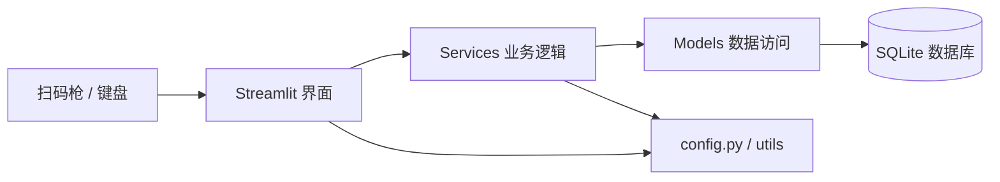

# 铺掌柜 ShopKeeper

> **零售进销存管理系统 · 扫码收银 · 库存管家**

基于 **Python + Streamlit + SQLite** 的本地零售管理工具，面向小商店、便利店与个体经营者。覆盖扫码销售、扫码入库、退货、进货单、会员、供应商、库存盘点、销售分析与数据备份。所有数据保存在本机，不依赖网络服务。

`Python 3.9+` · `Streamlit 1.30+` · `SQLite` · `MIT License`

---

## 目录

- [功能一览](#功能一览)
- [快速开始](#快速开始)
- [打包为免安装程序](#打包为免安装程序)
- [项目结构](#项目结构)
- [配置说明](#配置说明)
- [数据与安全](#数据与安全)
- [常见问题](#常见问题)
- [许可证](#许可证)

---

## 功能一览

| 模块 | 主要能力 |
|------|----------|
| 📊 数据看板 | 销售额、利润、库存健康度一览；低库存与临期商品预警 |
| 🛒 销售模式 | 条码扫码、购物车合并同类、库存预占校验、事务性扣减结算 |
| 📦 入库模式 | 已有商品追加库存、新商品登记、拼音码生成、生产日期与保质期计算 |
| 🔄 退货管理 | 扫码退货、库存回滚、退款统计、历史追踪 |
| 📝 商品管理 | 搜索 / 筛选 / 排序、批量编辑、进售价与警戒库存维护 |
| 📋 进货管理 | 进货单检索、临期高亮、售空标记、保质期筛选 |
| 👤 会员管理 | 会员档案、积分累计与兑换 |
| 🏭 供应商管理 | 供应商档案与联系方式维护 |
| 📋 库存盘点 | 盘点差异确认、库存校正 |
| 📦 批量操作 | 批量入库、批量调价、Excel 批量导入 |
| 🏷️ 打印标签 | 商品价签 HTML 生成与打印预览 |
| 💾 数据备份 | 自动 / 手动备份、历史备份恢复（二次确认） |

### 工作流程



---

## 快速开始

### 1. 环境要求

- Windows 10/11，Python 3.9 及以上
- 依赖版本见 [`requirements.txt`](requirements.txt)

### 2. 安装依赖

```bash
cd ShopKeeper
python -m venv .venv
.venv\Scripts\python.exe -m pip install -r requirements.txt
```

### 3. 启动应用

```bash
.venv\Scripts\python.exe -m streamlit run streamlit_app.py
```

首次启动会自动建库；若数据库为空且存在 `data/商品资料.xlsx`（或根目录同名文件），会自动迁移商品主数据并创建一份备份。

---

## 打包为免安装程序

```bash
.venv\Scripts\python.exe build.py             # 目录版（推荐）+ UPX 压缩 + zip 分发包
.venv\Scripts\python.exe build.py --onefile   # 单文件 exe（启动较慢）
.venv\Scripts\python.exe build.py --no-upx    # 关闭 UPX 压缩
.venv\Scripts\python.exe build.py --check     # 只做环境自检，不打包
```

| 项目 | 说明 |
|------|------|
| 程序图标 | 项目根目录 `icon.ico`；缺失时自动生成备用图标 |
| UPX | 默认 `H:\UPX\upx.exe`，可用 `--upx-dir` 指定其他目录 |
| 产物位置 | `dist/ShopKeeper_<时间戳>/`；zip 包固定为 `dist/ShopKeeper_v4.1.0_win_x64.zip` |
| 运行方式 | 双击 exe，自动选择空闲端口并打开浏览器 |

> **UPX 说明**：PyInstaller 6 生成的 exe 默认启用 CFG，UPX 5 需以 `--force` 压缩（会关闭 CFG 标记）。压缩后二进制可能被部分杀毒软件误报，如需规避请使用 `--no-upx` 重新打包。

---

## 项目结构

```text
ShopKeeper/
├── launcher.py            # 免安装版启动器（数据目录、端口、浏览器）
├── streamlit_app.py       # 应用入口与分组导航
├── config.py              # 品牌、路径、业务阈值统一配置
├── build.py               # 一键打包脚本
├── requirements.txt       # 依赖清单
├── icon.ico               # 程序图标
├── database/              # 建表与 Excel 迁移（兼容 data/database/）
├── models/                # 数据访问层
├── services/              # 业务逻辑层
├── ui/                    # 页面与通用组件
├── utils/                 # 日志、校验、辅助函数
├── data/                  # 运行数据：数据库、备份、日志、种子 Excel
└── dist/                  # 打包产物（构建后生成）
```

---

## 配置说明

业务阈值与品牌信息集中在 `config.py`，包括库存预警、保质期预警、默认分页与日期范围。打包运行时可通过环境变量覆盖数据位置：

| 环境变量 | 用途 |
|----------|------|
| `SHOPKEEPER_DATA_DIR` | 数据根目录 |
| `SHOPKEEPER_DB_PATH` | 数据库文件完整路径 |
| `SHOPKEEPER_LOG_DIR` | 日志目录 |
| `SHOPKEEPER_BACKUP_DIR` | 备份目录 |

---

## 数据与安全

- **程序与数据分离**：exe 同级 `data/` 保存数据库、备份与日志；升级时替换程序文件即可，数据不受影响。
- **备份恢复**：需先勾选确认框，恢复前自动对 WAL 日志执行 checkpoint，避免丢失未落盘事务。
- **扫码枪设置**：请设置为「自动回车」模式；扫码框会自动聚焦，可连续扫码。
- **版本控制**：`.gitignore` 已排除虚拟环境、构建产物、数据库、备份与日志，仅源码与种子数据纳入版本管理。

---

## 常见问题

**Q：启动后浏览器没有自动打开？**
A：启动器会在控制台打印实际地址（如 `http://127.0.0.1:58900`），复制到浏览器即可。端口每次自动选择空闲值，避免冲突。

**Q：打包版报缺少模块或数据文件？**
A：请使用最新 zip 重新解压。`build.py` 已显式收集 Streamlit 动态导入与 `xpinyin/Mandarin.dat`；旧解压目录不会自动更新。

**Q：杀毒软件报毒？**
A：UPX 加壳会提高误报率，使用 `build.py --no-upx` 重新打包即可。

---

## 许可证

MIT
